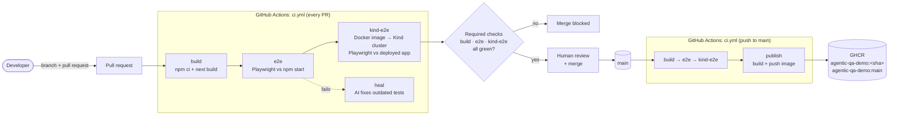
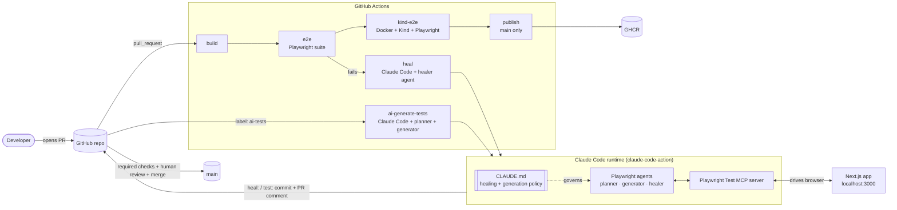
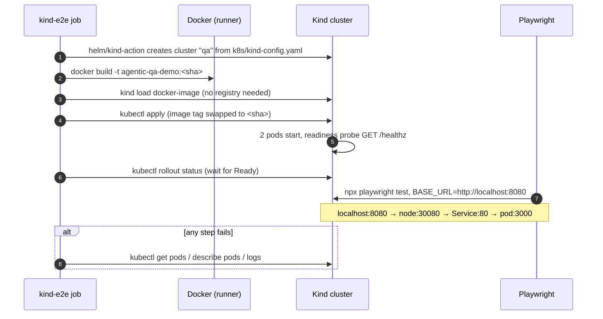
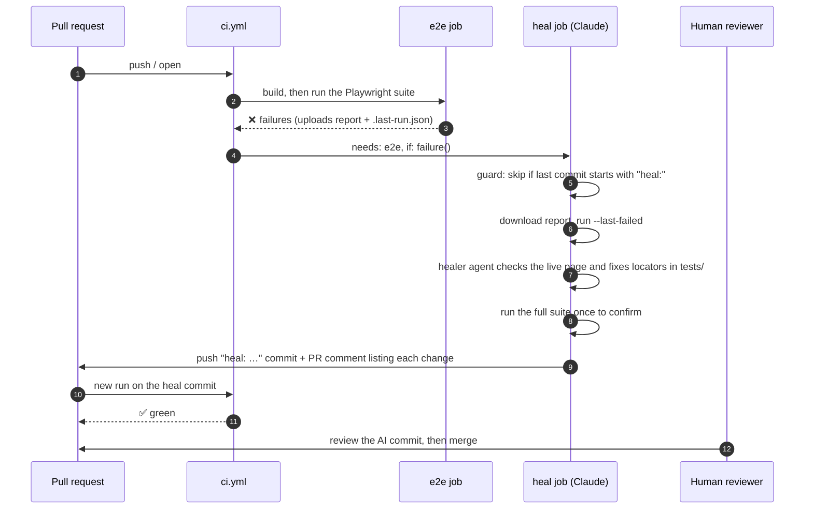
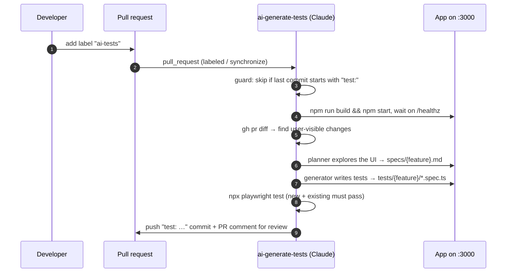

# Agentic QA Demo

[](https://github.com/zbasmajian/agentic-qa-demo/actions/workflows/ci.yml)

An **end-to-end software delivery pipeline** for a small web app, with **agentic AI test automation** built into it. Every change goes through a pull request. GitHub Actions builds the app, tests it, packages it as a **Docker** image, deploys that image to a short-lived **Kubernetes** cluster (Kind), and tests the deployed app. Only when every required check is green can the PR be merged. Each merge to `main` then publishes a versioned image to **GitHub Container Registry (GHCR)**.

On top of that pipeline, AI agents plan, generate and self-heal Playwright end-to-end tests, and written guardrails keep every AI change scoped, cheap and reviewed by a human.

The app is deliberately small (a Next.js "Sprint Task Board"), so the focus stays on the engineering around it: CI/CD, containers, Kubernetes, branch protection, test architecture and AI agents.

---

## Contents

- [Delivery lifecycle](#delivery-lifecycle)
- [Capabilities](#capabilities)
- [Architecture](#architecture)
- [Repository layout](#repository-layout)
- [The app under test](#the-app-under-test)
- [Containers and Kubernetes](#containers-and-kubernetes)
- [CI/CD workflows](#cicd-workflows)
- [Test suite design](#test-suite-design)
- [AI agents](#ai-agents)
- [Guardrails](#guardrails)
- [Performance tuning](#performance-tuning)
- [Results from real runs](#results-from-real-runs)
- [Getting started](#getting-started)
- [Setting up the AI workflows](#setting-up-the-ai-workflows)
- [Roadmap](#roadmap)
- [Further reading](#further-reading)

---

## Delivery lifecycle



### How a change flows

1. **Branch and pull request.** All work happens on a branch. The `protect-main` ruleset blocks direct pushes, force pushes and deletion of `main`, so every change reaches it through a PR.
2. **`build`.** `npm ci` and `next build` on a fresh Ubuntu runner. It catches compile and type errors.
3. **`e2e`.** The full Playwright suite runs against the app started with `npm start`. It checks user-visible behavior.
4. **`kind-e2e`.** The job builds the **Docker image** tagged with the commit SHA and creates a **Kind** (Kubernetes in Docker) cluster on the runner. It loads the image, deploys it with the Kubernetes manifests in `k8s/` and waits for the readiness probes, then runs the same Playwright suite against the **deployed** app. This catches problems `e2e` can't see: a wrong port, a failing probe, a broken image or a bad manifest.
5. **`heal` (only if `e2e` fails).** An AI agent decides whether the tests are out of date or the app is broken. It fixes outdated tests on the PR branch, or stops and reports a real bug.
6. **Required checks.** `build`, `e2e` and `kind-e2e` are required status checks. The Merge button stays blocked until all three are green.
7. **Human review and merge.** A person reviews the code and any AI commits, then merges.
8. **`publish` (only on `main`).** After the merge, the pipeline runs again on `main`. Once `kind-e2e` passes, the image is pushed to GHCR under two tags: the commit SHA (permanent, for exact deploys and rollbacks) and `main` (always the newest).

### Skills this project demonstrates

| Area | What's in this repo |
|---|---|
| **CI/CD** | Multi-job GitHub Actions pipeline with job dependencies (`needs`), conditions (`if`), caching, artifacts, least-privilege `permissions`, and separate PR and `main` behavior |
| **Containers** | Multi-stage Dockerfile, non-root runtime user, Next.js standalone output, `.dockerignore`, images tagged by commit SHA |
| **Kubernetes** | Deployment with replicas, readiness and liveness probes, CPU/memory requests and limits; NodePort Service; Kind cluster config with port mapping; rolling updates |
| **Release management** | Versioned images published to GHCR only after the deployed artifact passed its tests |
| **Source control and governance** | Branch protection ruleset, required status checks, PR-only changes to `main`, human review |
| **Test automation** | Playwright, Page Object Model, fixtures, accessible locators, test plans that trace to tests, fast-feedback tuning |
| **AI engineering** | Claude Code agents for test planning, generation and self-healing, connected through MCP and governed by a written policy, with cost and loop controls |

---

## Capabilities

| Capability | What it does | Where |
|---|---|---|
| **Containerized app** | A multi-stage, non-root Docker image (~219 MB) built from Next.js standalone output | `Dockerfile`, `.dockerignore` |
| **Kubernetes deployment** | 2 replicas with readiness/liveness probes on `/healthz` and resource limits, behind a NodePort Service | `k8s/app.yaml` |
| **Testing the deployed artifact** | Every PR gets its own short-lived Kind cluster in CI; the e2e suite runs against the deployed image | `kind-e2e` job in `ci.yml` |
| **Merge gate** | `build`, `e2e` and `kind-e2e` must pass before a PR can merge into `main` | `protect-main` ruleset |
| **Continuous delivery** | Each merge to `main` publishes the image to GHCR, tagged with the commit SHA and `main` | `publish` job in `ci.yml` |
| **AI test planning** | An agent explores the running app in a real browser and writes a structured test plan (scenarios, steps, expected results) | `playwright-test-planner` → `specs/*.md` |
| **AI test generation** | An agent turns each plan scenario into a Playwright test that uses the shared page object | `playwright-test-generator` → `tests/**` |
| **Self-healing tests** | When e2e fails on a PR, an agent finds the root cause, fixes the *tests* (never the app), pushes a `heal:` commit and explains each change in a PR comment | `heal` job in `ci.yml` |
| **Generation on demand** | Adding the `ai-tests` label to a PR makes an agent read the diff, plan the user-visible changes, generate tests, run them and push a `test:` commit | `ai-generate-tests.yml` |
| **Policy-governed AI** | A written healing and generation policy says what agents may and may not change. Agents read it from `CLAUDE.md` | `CLAUDE.md`, `docs/healing-policy.md` |
| **Bug vs. outdated test** | The healer separates "the app changed on purpose" (heal the test) from "the app is broken" (stop and report) | healing policy |
| **Fast feedback** | Fail-fast timeouts, parallel workers, an early stop on mass failure, browser caching, and a healer that re-runs only the failed tests | `playwright.config.ts`, workflows |
| **Health-checked app** | `/healthz` lets Playwright, CI and the Kubernetes probes wait until the app is ready | `src/app/healthz/route.ts` |

---

## Architecture

### System overview



### Deploy-and-test flow (`kind-e2e`, every PR)



### Self-healing flow (every PR)



### Generation flow (label-triggered)



---

## Repository layout

```text
.
├── src/app/
│   ├── page.tsx                 # App under test: Sprint Task Board
│   ├── layout.tsx
│   └── healthz/route.ts         # GET /healthz → {"status":"ok"}
├── Dockerfile                   # Multi-stage image: build, then a slim non-root runtime
├── .dockerignore                # Keeps node_modules, .next, test output, .git, .env out of the build
├── k8s/
│   ├── kind-config.yaml         # Kind cluster: 1 node, localhost:8080 → NodePort 30080
│   └── app.yaml                 # Deployment (2 replicas, probes, limits) + NodePort Service
├── specs/                       # Test plans (written by the planner, reviewed by humans)
│   ├── adding-task.md           #   10 scenarios
│   ├── clear-all.md             #    8 scenarios (generated in CI, PR #7)
│   └── free-shipping.md         #   sample requirements doc (not implemented in the app)
├── tests/
│   ├── pages/task-board-page.ts # Page object: every locator lives here
│   ├── fixtures.ts              # `taskBoard` fixture: opens a fresh board
│   ├── feature/*.spec.ts        # 10 tests from specs/adding-task.md
│   ├── clear-all/*.spec.ts      #  8 tests from specs/clear-all.md
│   ├── smoke.spec.ts            # Smoke test
│   └── seed.spec.ts             # Seed test the agents use to open the app
├── .claude/agents/              # Playwright planner / generator / healer agent definitions
├── .github/workflows/
│   ├── ci.yml                   # build → e2e → kind-e2e → publish (main), plus heal
│   └── ai-generate-tests.yml    # label-triggered AI test generation
├── .mcp.json                    # Playwright Test MCP server (local, Windows: `cmd /c npx …`)
├── .mcp.ci.json                 # Same server for Linux CI runners (`npx …`)
├── CLAUDE.md                    # Policy that every Claude session and subagent reads
├── docs/healing-policy.md       # Source of the healing policy
├── next.config.ts               # Includes output: "standalone" for the Docker image
├── playwright.config.ts
├── LEARNING.md                  # Lab notes: decisions, run results, costs, lessons
└── agentic-qa-lab-workbook.md   # The lab workbook this project follows
```

---

## The app under test

A one-page Next.js 16 / React 19 app styled with Tailwind CSS:

- A heading, **Sprint Task Board**
- A text box labelled **Task Input** and a **Create Task** button. The form also submits on Enter.
- A task list, seeded with *"Deploy CI/CD pipeline"*. Each task has a **Delete task: &lt;name&gt;** button.
- A **Clear all** button, shown only while the list has at least one task
- Input is trimmed, and empty or whitespace-only input is ignored. Tasks live in React state, so a reload resets the list.

Every interactive element has an accessible name, so tests can use role-based locators instead of CSS selectors.

---

## Containers and Kubernetes

### Docker image (`Dockerfile`)

| Choice | Why |
|---|---|
| **Two stages** | The build stage installs all dependencies and runs `next build`. The runtime stage copies only the result, so build tools never ship. |
| **Next.js standalone output** | `output: "standalone"` bundles a minimal `server.js` with only the `node_modules` it needs. The runtime stage needs no `npm ci`. Image size: ~219 MB, most of it the `node:22-alpine` base. |
| **Non-root user** | The container runs as `node`, not `root`. |
| **`HOSTNAME=0.0.0.0`, port 3000** | The server listens on all interfaces, so Docker port mappings and the Kubernetes Service can reach it. |
| **Tagged by commit SHA** | Every commit produces its own image (`agentic-qa-demo:<sha>`), never `latest`. The image tested in Kind is built from the same commit as the one published. |

### Kubernetes manifests (`k8s/`)

| Object | Key settings | Why |
|---|---|---|
| **Kind cluster** (`kind-config.yaml`) | 1 control-plane node; `extraPortMappings` 8080 → 30080 | A full cluster on a laptop or CI runner in about a minute, reachable at `http://localhost:8080` |
| **Deployment** (`app.yaml`) | 2 replicas; `imagePullPolicy: IfNotPresent` | Survives a pod dying; uses the image loaded with `kind load` instead of pulling from a registry |
| | Readiness probe `GET /healthz` | A pod gets traffic only once it answers. This keeps rolling updates from sending users to pods that aren't ready. |
| | Liveness probe `GET /healthz` | A hung container is restarted automatically |
| | Requests 100m CPU / 256Mi, limits 500m / 512Mi | Predictable scheduling; one pod can't starve the node |
| **Service** (`app.yaml`) | `NodePort` 30080 → port 80 → container 3000 | A stable address in front of pods that come and go |

Request path from a browser or Playwright:

```text
localhost:8080 → (Kind port mapping) node:30080 → (NodePort Service) Service:80 → pod:3000 → Next.js
```

---

## CI/CD workflows

### `ci.yml`: build → e2e → kind-e2e → publish, plus heal

The workflow runs on every **pull request** and on every **push to `main`**. The same jobs run in both cases. Only `publish` is limited to `main`.

| Job | Runs when | What it does |
|---|---|---|
| `build` | every PR, push to `main` | `npm ci` + `npm run build` |
| `e2e` | after `build` | Restores the cached browser, runs `npx playwright test` (Playwright starts the app through `webServer`), and uploads `playwright-report/` and `test-results/` (including `.last-run.json`) |
| `kind-e2e` | after `e2e` passes | Creates a Kind cluster (`helm/kind-action`), builds the image tagged with `github.sha`, `kind load`s it, deploys `k8s/app.yaml` with the tag swapped in, waits for `rollout status`, runs Playwright against `http://localhost:8080`. On failure, prints pods, events and logs. |
| `publish` | after `kind-e2e`, **only** `if: github.ref == 'refs/heads/main'` | Logs in to `ghcr.io` with `GITHUB_TOKEN` (`permissions: packages: write`) and pushes `ghcr.io/zbasmajian/agentic-qa-demo:<sha>` and `:main`. Shows as *skipped* on PRs. |
| `heal` | `e2e` failed **and** the event is a PR | Loop guard → install → download the e2e results → Claude runs the healer on `--last-failed` → full-suite check → `heal:` commit + PR comment |

### Branch protection (`protect-main` ruleset)

- Changes reach `main` only through a pull request. Force pushes and branch deletion are blocked.
- **Required status checks:** `build`, `e2e`, `kind-e2e`, each tied to GitHub Actions as the source. `heal` and `publish` are deliberately not required: `heal` is a helper, and `publish` never runs on PRs.
- `e2e` is required as well as `kind-e2e`, because a check skipped by a failed dependency would otherwise count as passing.

### `ai-generate-tests.yml`: label-triggered generation

- **Trigger:** `pull_request` with `types: [labeled, synchronize]`. The job runs only `if: contains(labels, 'ai-tests')`.
- **Steps:** loop guard (`test:`) → install with the browser cache → `npm run build && (npm start &)` → wait on `/healthz` → Claude reads `gh pr diff`, runs the planner, runs the generator, runs the suite, commits `test: …` and comments.
- **`BASE_URL: http://localhost:3000`** is set at job level. This makes `playwright.config.ts` skip its own `webServer`, so the tests and the MCP browser reuse the app the job started instead of fighting over port 3000.

---

## Test suite design

| Principle | How it's applied |
|---|---|
| **Page Object Model** | `TaskBoardPage` owns every locator and action (`addTask`, `addTasks`, `deleteButton`, …), plus a few shared assertions (`expectTasks`, `expectUnchanged`). When a locator breaks, the fix usually belongs in one place. The PR #10 heal changed one page-object line, which fixed 14 failing tests. |
| **Fixtures** | `tests/fixtures.ts` provides `taskBoard`, a board opened fresh at `/` for every test, so tests stay independent and can run in parallel. |
| **Accessible locators only** | `getByRole` / `getByLabel` with accessible names. CSS and XPath selectors are banned by policy. |
| **Plans trace to tests** | Each scenario in `specs/*.md` (for example *1.6 Leading and trailing whitespace is trimmed*) maps to one spec file under `tests/`. Plans are the human-readable source of truth for what the app should do. |
| **Edge cases included** | Duplicates, HTML and special characters, very long input, whitespace handling, no persistence across reload. |
| **One suite, any environment** | `BASE_URL` points the same tests at `npm run dev`, `npm start`, a container or the Kind cluster. |

**Current suite:** 20 tests (10 adding-task, 8 clear-all, a smoke test and a seed test), all passing on `main`, both against `npm start` and against the deployed image in Kind.

---

## AI agents

The agents are Playwright's test agents (`npx playwright init-agents`), stored as Claude Code subagents in `.claude/agents/`. They drive a real browser through the **Playwright Test MCP server** (`npx playwright run-test-mcp-server`).

| Agent | Input | Output | Can edit |
|---|---|---|---|
| `playwright-test-planner` | The running app + a feature description or PR diff | A structured plan in `specs/<feature>.md` | `specs/` |
| `playwright-test-generator` | A plan scenario | A Playwright test, verified by running it | `tests/` |
| `playwright-test-healer` | Failing tests + a live page snapshot | Fixed locators, waits or test data | `tests/`, plus name-only updates in `specs/` |

**Locally,** the agents run inside Claude Code (for example, *"use the planner to write a plan for the Clear all button"*).
**In CI,** they run through [`anthropics/claude-code-action@v1`](https://github.com/anthropics/claude-code-action) in automation mode: a `prompt` plus `claude_args` such as `--max-turns`, `--mcp-config` and `--allowedTools`.

---

## Guardrails

Changes, human or AI, need to be **safe, tested and auditable**. Each concern has a specific control:

| Concern | Control |
|---|---|
| **Untested code on `main`** | `protect-main` ruleset: PR-only changes and required checks `build`, `e2e`, `kind-e2e`. |
| **Untested images in the registry** | `publish` needs `kind-e2e` and runs only on `main`, so only images whose deployment passed e2e reach GHCR. |
| **Least privilege in CI** | `publish` gets only `contents: read` and `packages: write`. The registry login uses the run's short-lived `GITHUB_TOKEN`, not a stored password. |
| **Container hardening** | Non-root runtime user, minimal standalone output, no dev dependencies or source in the runtime image. |
| **AI scope** | The policy in `CLAUDE.md` / `docs/healing-policy.md`: the healer edits only `tests/` (and `specs/` for name changes only). The generator edits only `specs/` and `tests/`. Neither may touch `src/`, `playwright.config.ts` or workflows. |
| **Test integrity** | Agents must never delete or loosen assertions, change expected values to match new behavior, add `test.skip()` / `test.fixme()`, or switch to CSS or XPath selectors. |
| **Real bugs** | A 5xx, a runtime error, a blank page, behavior that contradicts the spec, or a rename that looks accidental (like `Task Input` → `Task2 Input`) means **stop and report** with evidence and a suggested app fix. The agent changes nothing. |
| **Blast radius** | A fix that would change more than a few locators goes to a human. |
| **Tool access** | `--allowedTools` allows only file tools, `npx playwright`, `git`, `gh pr diff` / `gh pr comment` and the Playwright MCP server. There's no general shell access. |
| **AI cost** | `--max-turns 30`, `timeout-minutes: 30`, and generation only runs when a human adds the `ai-tests` label. |
| **Loops** | `heal` skips itself if the last commit starts with `heal:`, and generation skips if it starts with `test:`. This matters because pushes made with the Claude GitHub App's token *do* start new workflow runs. |
| **Human in the loop** | Every AI commit lands on the PR branch with a comment listing each change and flagging any assertion change. A human reviews before merge. |
| **Secrets** | `ANTHROPIC_API_KEY` is stored only as a GitHub Actions secret and never committed. `.env` files are excluded from Git and from the Docker build context. |

---

## Performance tuning

A failing run used to take about **15 minutes**: 14 failures × 2 attempts × a 30 s default timeout, on 1 worker. The current settings:

| Setting | Value (CI) | Effect |
|---|---|---|
| `actionTimeout` / `expect.timeout` | 5 s | A missing element fails after 5 s instead of 30 s |
| `timeout` (per test) | 15 s | Caps a stuck test |
| `workers` | 4 | Uses all 4 vCPUs on GitHub's Linux runners |
| `maxFailures` | 5 | Stops early on a mass failure, which usually has one root cause, and hands over to the healer |
| `retries` | 1 | Absorbs flaky tests; with fast timeouts, a retry is cheap |
| Browser cache | `~/.cache/ms-playwright`, keyed on `package-lock.json` | Skips the browser download on a cache hit |
| Healer `--last-failed` | from `.last-run.json` | The healer reproduces only the failures, not the whole suite |

A green run's test step takes about **15–20 s** in CI. A full PR pipeline (`build` → `e2e` → `kind-e2e`) takes about 4–5 minutes, most of it creating the Kind cluster and building the image.

---

## Results from real runs

| PR | Workflow | Outcome | AI cost |
|---|---|---|---|
| [#7](https://github.com/zbasmajian/agentic-qa-demo/pull/7): Clear all button | `ai-generate-tests` | Plan with 8 scenarios + 8 tests + a page-object locator. 20/20 passing. The agent also flagged an accidental `Task2 Input` rename on `main`, which was then reverted. | ~$0.42 (9 turns) |
| [#10](https://github.com/zbasmajian/agentic-qa-demo/pull/10): rename *Add Task* → *Create Task* | `heal` | Red (14/20 failing) → `heal:` commit changing 2 locators, no assertions changed → green 20/20. The agent checked the rename in a live page snapshot first. | ~$0.42 (10 turns) |
| [#13](https://github.com/zbasmajian/agentic-qa-demo/pull/13): Docker image + Kind deploy in CI | `ci.yml` | First `kind-e2e` run: image built, deployed to Kind, 2 pods Ready, 20/20 tests passed against the deployed app (2m14s). | – |
| [#14](https://github.com/zbasmajian/agentic-qa-demo/pull/14): readiness probe pointed at `/nope` (on purpose) | `ci.yml` | `build` ✅ and `e2e` ✅, because `e2e` can't see a broken manifest. **`kind-e2e` ❌**: pods stuck at `0/1`, and the debug step showed `Readiness probe failed: HTTP probe failed with statuscode: 404`. Closed without merging. | – |
| [#15](https://github.com/zbasmajian/agentic-qa-demo/pull/15): `publish` job | `ci.yml` | On the PR: `publish` skipped and the merge `BLOCKED` until `kind-e2e` passed. After the merge: `publish` pushed `ghcr.io/zbasmajian/agentic-qa-demo:<sha>` and `:main`. | – |

The AI runs stayed inside policy. There were no edits to `src/` and no weakened assertions, and every change was explained in a PR comment. PR #14 shows why testing the deployed artifact matters: the plain e2e job called it green. See [`LEARNING.md`](LEARNING.md) for the full write-ups and lessons.

---

## Getting started

**Prerequisites:** Node.js 22 and Git. For the container and Kubernetes loop: Docker, [kind](https://kind.sigs.k8s.io/) and kubectl. Optionally, [Claude Code](https://claude.com/claude-code) to run the agents locally.

### Run and test the app

```bash
npm ci
npx playwright install chromium

npm run dev            # dev server on http://localhost:3000
# or, production-like:
npm run build && npm start

npx playwright test    # runs the suite (starts the app via webServer if needed)
npx playwright show-report
```

If the app is already running, point the tests at it and skip `webServer`:

```bash
BASE_URL=http://localhost:3000 npx playwright test
```

### Run it in Docker

```bash
docker build -t agentic-qa-demo:dev .
docker run --rm -p 3000:3000 agentic-qa-demo:dev
```

### Deploy it to a local Kubernetes cluster (Kind)

```bash
kind create cluster --name qa --config k8s/kind-config.yaml
docker build -t agentic-qa-demo:dev .
kind load docker-image agentic-qa-demo:dev --name qa
kubectl apply -f k8s/app.yaml
kubectl rollout status deployment/agentic-qa-demo --timeout=120s
curl http://localhost:8080/healthz
BASE_URL=http://localhost:8080 npx playwright test

kind delete cluster --name qa   # clean up
```

### Pull the published image

```bash
docker pull ghcr.io/zbasmajian/agentic-qa-demo:main
```

The package is private by default. Log in first with `gh auth token | docker login ghcr.io -u <user> --password-stdin`, or make it public in the package settings.

### Run the agents locally

Open Claude Code in the repo. It picks up `.mcp.json` and `.claude/agents/`. Then ask, for example:

- *"Use the playwright-test-planner to write a test plan for the Clear all button in specs/."*
- *"Use the playwright-test-generator to write tests for specs/clear-all.md."*
- *"Run the tests and use the playwright-test-healer to fix any failures."*

`.mcp.json` uses `cmd /c npx …` for Windows. On macOS or Linux, use `.mcp.ci.json` (or edit the command to plain `npx`).

---

## Setting up the AI workflows

1. **API key:** create one in the [Anthropic Console](https://console.anthropic.com) (Settings → API Keys; the account needs credits), then add it as a repository secret:
   ```bash
   gh secret set ANTHROPIC_API_KEY   # paste the key when prompted
   ```
   Or use GitHub: **Settings → Secrets and variables → Actions → New repository secret**. If the workflow log shows `ANTHROPIC_API_KEY:` with nothing after it, the secret is empty.
2. **Label:** `gh label create ai-tests --color 5319E7`
3. **Try healing:** open a PR that renames a button. Watch e2e go red, then the `heal:` commit, then green.
4. **Try generation:** open a PR that adds a small feature and add the `ai-tests` label. Watch for the `test:` commit with a new spec and tests.
5. **Review** every AI commit before merging.

The run summary of each Claude step shows the turns used and the cost (`num_turns`, `total_cost_usd`).

---

## Roadmap

- [x] Testable app with `/healthz` and a production-like build
- [x] Playwright foundation, page object, fixtures and seed test
- [x] AI planner, generator and healer agents, governed by policy
- [x] CI pipeline (`build` → `e2e`) on every PR
- [x] Self-healing and label-triggered AI test generation in CI
- [x] Fast-feedback tuning (timeouts, workers, early stop, caching, last-failed)
- [x] Containerize the app (multi-stage, non-root image tagged with the commit SHA)
- [x] Run e2e against the app deployed on a local Kind (Kubernetes in Docker) cluster
- [x] A short-lived Kind cluster per PR in CI, then publish versioned images to GHCR on merge
- [x] Required status checks (`build`, `e2e`, `kind-e2e`) in the `protect-main` ruleset
- [ ] `preStop` hook so rolling updates drop no requests while old pods shut down
- [ ] Scan the image for vulnerabilities (for example Trivy) before publishing
- [ ] Promote the exact tested image bytes from `kind-e2e` to `publish` instead of rebuilding
- [ ] GitOps deployment of the published image to a long-lived cluster (for example Argo CD)

---

## Further reading

- [`LEARNING.md`](LEARNING.md): decisions, mistakes, run results and costs, lab by lab
- [`docs/healing-policy.md`](docs/healing-policy.md): the full healing policy
- [`CLAUDE.md`](CLAUDE.md): healing and generation policy loaded by every agent
- [`agentic-qa-lab-workbook.md`](agentic-qa-lab-workbook.md): the lab workbook
- [Playwright test agents](https://playwright.dev/docs/test-agents) · [Claude Code GitHub Action](https://github.com/anthropics/claude-code-action)
- [kind](https://kind.sigs.k8s.io/) · [Kubernetes probes](https://kubernetes.io/docs/concepts/workloads/pods/pod-lifecycle/#container-probes) · [GitHub Container Registry](https://docs.github.com/packages/working-with-a-github-packages-registry/working-with-the-container-registry)
