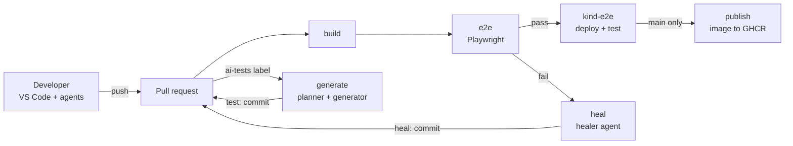

# Agentic QA Lab Workbook: Playwright Agents + GitHub Actions + Kind

Nov 11, 2026 · @Zohrab

## How to use this workbook

You will build the whole pipeline yourself, on your own app in `C:\Workspace\agentic-qa-demo`, across 11 labs and a capstone. By the end, every push runs Playwright tests in GitHub Actions, AI agents plan, generate and heal those tests, and the app is built into a container and deployed to a Kind (Kubernetes in Docker) cluster before the tests run against it.

**Every lab has the same parts:**

- **Goal:** what you will be able to do afterwards.
- **Learn:** the ideas to understand before you type anything.
- **Steps:** what you do. The code snippets are references. Type them yourself and adapt them to your app rather than pasting them blindly.
- **Checkpoint:** a pass/fail check. Don't move on until every box is ticked.
- **Stretch:** optional extras if you want to go deeper.

**Working rules:**

- Use one Git branch per lab, for example `lab-02-playwright`. Open a pull request (PR) and merge it when the checkpoint passes. Your PR history then becomes your learning log.
- Use Claude in VS Code to *explain* things to you ("why does this config need baseURL?"), not to do the lab for you. The labs that use the Playwright agents are the exception, because driving those agents is the skill you are learning there.
- Keep a `LEARNING.md` file in the repo. After each lab, write 3 to 5 lines on what you learned and what broke.

**Assumptions:** your app is a Node.js/TypeScript web app that starts with an npm script (for example `npm run dev` or `npm start`) and serves HTTP on a port such as 3000. If your setup is different, swap in your own commands and port wherever this workbook says `3000` or `npm start`.

**What you are building:**



The shaded jobs are the AI agents. Healer and generator commits go back to the PR, so CI runs again and a human reviews them before merge.

## Lab 0 – Toolchain setup on Windows

**Goal:** every tool used in the later labs is installed and its version check prints.

**Learn:** Kind runs each Kubernetes "node" as a Docker container, so Docker Desktop (with the WSL 2 backend) must be running before any `kind` command will work. Playwright runs on Node, and its AI agents run inside Claude Code through an MCP server that Playwright ships.

**Steps** (in PowerShell):

1. Install Node.js 22 LTS or newer, Git, and VS Code. You probably have these already.
2. Install Docker Desktop and turn on *Use the WSL 2 based engine* in Settings → General.
3. Install Kind and kubectl: `winget install Kubernetes.kind` and `winget install Kubernetes.kubectl`.
4. Install the GitHub CLI: `winget install GitHub.cli`, then run `gh auth login`.
5. In VS Code, install the **Claude Code** extension and the **Playwright Test for VS Code** extension.
6. Create an Anthropic API key in the Claude Console. You'll add it as a GitHub secret in Lab 7. Never commit it to the repo.

**Checkpoint**

- [ ] `node -v` prints v22 or higher
- [ ] `docker run --rm hello-world` succeeds
- [ ] `kind version` and `kubectl version --client` both print versions
- [ ] `gh auth status` shows you're logged in
- [ ] Claude Code opens in VS Code and answers a question about your repo

**Stretch:** write `scripts/check-tools.ps1`, a script that runs all of the checks above and exits non-zero if any of them fail.

## Lab 1 – Make the app testable and push to GitHub

**Goal:** your app starts with one command, tells you whether it's healthy, runs on any port you choose, and lives in a GitHub repo where `main` is protected.

**Time:** 1 to 2 hours. **You need:** Lab 0 finished.

**Why this matters:** later, robots will start your app (GitHub Actions, Docker, Kubernetes) and test it (Playwright). A robot can't click around to find out whether the app is up. It needs:

- a fixed command to start it
- a way to choose which port it uses
- an address it can call to ask "are you alive?"

This lab adds all three.

### Part A – Get to know your project (15 min)

1. Open VS Code. Choose **File → Open Folder…**, select `C:\Workspace\agentic-qa-demo`, and click **Select Folder**. The **Explorer** panel on the left now lists your project's files.
2. Open a terminal inside VS Code with **View → Terminal** (or press Ctrl+\`). A panel opens at the bottom, already *in* your project folder. Every command in this workbook is typed here.
3. In Explorer, click `package.json` to open it. This file is your project's ID card. Find these two sections:
   - `"scripts"`: shortcuts you run with `npm run <name>`. For example, `"dev": "..."` means `npm run dev` runs whatever is on the right.
   - `"dependencies"`: the libraries your app uses.
4. **Find out what kind of app you have.** Look in `"dependencies"` and match it to this table. The rest of this lab gives separate instructions for each kind.

| If dependencies include… | Your app is… | Follow the instructions marked |
| --- | --- | --- |
| `express` | An Express server | **\[Express\]** |
| `next` | A Next.js app | **\[Next.js\]** |
| none of these, but files use `http.createServer` | A plain Node server | **\[Express\]**: the same ideas apply |
| only `vite` / `react`, with no server | Front-end only | Ask Claude: *"Add a minimal Express server to serve my built Vite app"*, then follow **\[Express\]** |

5. **Find the file that starts the server.** Press Ctrl+Shift+F to search all files, type `listen(` and press Enter. The file it finds (often `src/server.ts`, `src/index.ts` or `server.js`) is your **server file**. Write its path down. Next.js apps have no such file, and that's fine.
6. **Learn with Claude:** open the Claude Code panel and ask: *"Explain what each file in this project does, in beginner terms. Don't change anything."* Copy the parts you find useful into a new file called `LEARNING.md`, using **File → New File**.

### Part B – Run the app the way it runs today (10 min)

1. In the terminal, type `npm install` and press Enter. This downloads every library listed in `package.json` into a `node_modules` folder. Wait for the prompt to come back.
2. Type `npm run dev` (or `npm start` if there's no `dev` script). Look at the output for a line like `listening on http://localhost:3000`. The number at the end is your **port**.
3. Open that address in your browser. You should see your app.
4. Go back to the terminal and press **Ctrl+C** to stop the app. You'll start and stop it many times. Ctrl+C always stops it.

✅ *Check:* you can start the app, see it in the browser, and stop it.

### Part C – Let the port be chosen from outside (15 min)

**Concept:** an *environment variable* is a named value you set *outside* the code, which the code reads when it starts. Docker and Kubernetes use them to tell your app which port to use. In Node you read one with `process.env.NAME`.

**\[Express\]** Open your server file and find the line containing `listen(`. It probably looks like `app.listen(3000, ...)`. Change it so the port comes from `PORT`, with 3000 as the fallback:

```ts
// near the top of the file, after the imports
const port = Number(process.env.PORT ?? 3000);

// at the bottom – replace your existing listen line
app.listen(port, '0.0.0.0', () => {
  console.log(`App listening on http://localhost:${port}`);
});
```

- `process.env.PORT ?? 3000` means "use PORT if it's set, otherwise use 3000".
- `'0.0.0.0'` means "accept connections from anywhere, not just this computer". Without it, the app is unreachable once it's inside a container in Lab 8.

**\[Next.js\]** You don't need to change any code: `next dev` and `next start` already read `PORT`. Open `package.json` and change the start script to `"start": "next start -H 0.0.0.0"`.

**Test it** in the terminal:

```powershell
$env:PORT = "4000"     # set the variable for this terminal only
npm run dev            # the log should now say 4000
```

Open http://localhost:4000, then press Ctrl+C. Run `Remove-Item Env:PORT` to unset the variable again.

✅ *Check:* the app runs on 3000 by default and on 4000 when `PORT` is set.

### Part D – Add a health-check route (20 min)

**Concept:** a *route* is an address your server answers, such as `/`, `/login` or `/api/items`. A *health check* is a tiny route that just says "I'm alive". Kubernetes will call it every few seconds, and Playwright will wait for it before running tests. By convention it's called `/healthz`. It returns HTTP status **200**, which means OK, with the body `{"status":"ok"}`.

**\[Express\]** In your server file, find where other routes are defined (lines like `app.get(...)` or `app.use(...)`). Add this **before** the `app.listen` line:

```ts
app.get('/healthz', (_req, res) => {
  res.status(200).json({ status: 'ok' });
});
```

Reading it piece by piece:

- `app.get('/healthz', ...)`: when someone sends a GET request to `/healthz`, run this function.
- `_req` is the incoming request. The underscore means "we don't use it".
- `res.status(200).json({...})` sends status 200 with a JSON body.

**\[Next.js\]** (App Router, if you have an `app/` folder): in Explorer, right-click the `app` folder, choose **New Folder** and name it `healthz`. Inside it, create a file called `route.ts` with:

```ts
export function GET() {
  return Response.json({ status: 'ok' });
}
```

If your project uses `pages/` instead, create `pages/api/healthz.ts`, and your address becomes `/api/healthz`. Use that path everywhere this workbook says `/healthz`.

**Test it:** start the app with `npm run dev`, then:

- **Browser:** open http://localhost:3000/healthz. You should see `{"status":"ok"}`.
- **Terminal:** open a second terminal tab (the **+** icon in the terminal panel) and run `Invoke-RestMethod http://localhost:3000/healthz`. It should print `status` and `ok`.

✅ *Check:* both tests show `ok`. If you see "Cannot GET /healthz", the route is missing or sits after `listen`. Restart the app and try again.

### Part E – Make build and start work like production (20 min)

**Concept:** your app can be run in two ways.

- `npm run dev` is for you: it watches your files and restarts when you edit them.
- `npm run build` + `npm start` is for robots: *build* converts your TypeScript into plain JavaScript once, and *start* runs that JavaScript. CI, Docker and Kubernetes all use this second way, so it has to work.

**\[Express\]**

1. Check that the build tools are installed. In `package.json`, look under `"devDependencies"` for `typescript` and `tsx`. If either is missing, run:

```powershell
npm install --save-dev typescript tsx @types/node @types/express
```

2. Open `tsconfig.json` (create it in the project root if it doesn't exist). Make sure `compilerOptions` contains these two settings. They tell TypeScript to read from `src/` and write the compiled JavaScript to `dist/`:

```json
{
  "compilerOptions": {
    "rootDir": "src",
    "outDir": "dist",
    "target": "ES2022",
    "module": "NodeNext",
    "moduleResolution": "NodeNext",
    "esModuleInterop": true,
    "strict": true
  }
}
```

3. In `package.json`, set the `"scripts"` section as below. Replace `server` with your server file's name from Part A, step 5. If you already have a `"test"` script, keep it.

```json
"scripts": {
  "dev": "tsx watch src/server.ts",
  "build": "tsc -p .",
  "start": "node dist/server.js"
}
```

**\[Next.js\]** You should already have `"build": "next build"` and `"start": "next start -H 0.0.0.0"` (from Part C). Nothing else to do.

**Test it:**

```powershell
npm run build   # Express: creates a dist folder; Next.js: creates .next
npm start       # runs the built app
```

Open http://localhost:3000/healthz, then press Ctrl+C.

✅ *Check:* `npm run build` finishes with no red errors, and `npm start` serves `/healthz`. If the build complains about type errors, paste the error into Claude and ask *"explain this error and how I'd fix it"*. Then make the fix yourself.

### Part F – Give buttons and fields real names (20 min)

**Concept:** Playwright, and its AI agents, find elements the way a screen reader does: by *role* and *name*, for example "the button named Save" or "the textbox labelled Email". If your HTML uses real elements, tests stay stable even when the styling changes.

| Instead of… | Use… | Why |
| --- | --- | --- |
| `<div onclick="save()">Save</div>` | `<button type="button" onclick="save()">Save</button>` | A `<div>` has no role, so a test can't ask for "the Save button" |
| `<input placeholder="Email">` | `<label for="email">Email</label> <input id="email">` | The label gives the field a name |
| `<span class="title">Todos</span>` | `<h1>Todos</h1>` | Headings let tests confirm which page loaded |
| An icon-only button `<button>🗑</button>` | `<button aria-label="Delete item">🗑</button>` | Gives the button a name a test can use |

1. Start the app and open your main page in Chrome.
2. Right-click a button and choose **Inspect**. In the DevTools panel that opens, select the **Accessibility** tab (in the Elements panel's side pane). It shows that element's *Role* and *Name*.
3. Check 3 to 5 elements a user interacts with most. Note any with no role, or an empty name.
4. Fix those in your HTML or JSX using the table above. Re-inspect them to confirm.

✅ *Check:* every element you checked shows a sensible Role (button, textbox, link, heading) and a Name.

### Part G – Tell Git what to ignore (5 min)

**Concept:** some folders are generated (`node_modules`, `dist`) or secret (`.env`). They must never be uploaded to GitHub. Git skips anything listed in a file called `.gitignore`.

1. In Explorer, hover over the project name at the top and click the **New File** icon. Name the file `.gitignore`, including the leading dot. If it already exists, open it instead.
2. Make sure it contains these lines:

```
node_modules/
dist/
.next/
test-results/
playwright-report/
.env
.env.*
```

3. Save with Ctrl+S.

### Part H – Put the project on GitHub (20 min)

**Concept:** *Git* records snapshots ("commits") of your files on your computer. *GitHub* is a website that stores a copy of those snapshots, called the *remote*, and runs automation on them. `gh` is GitHub's command-line tool.

1. Check whether the folder is already a Git repository: run `git status`.
   - If it says **"not a git repository"**, run `git init -b main`. This starts tracking the folder, with a main branch called `main`.
   - If it lists files or says "nothing to commit", it's already a repo. Skip to step 3.
2. Tell Git who you are (do this once per computer):

```powershell
git config --global user.name "Your Name"
git config --global user.email "you@example.com"
```

3. Take your first snapshot:

```powershell
git add .                                  # stage every file (except ignored ones)
git status                                 # review: node_modules must NOT appear
git commit -m "Lab 1: health check, PORT, build scripts"
```

4. Create the GitHub repo and upload your snapshot in one command:

```powershell
gh repo create agentic-qa-demo --public --source . --remote origin --push
```

- `--public` keeps branch protection free. See the note in Part I.
- `--source .` means "use this folder". `--push` uploads your commit.

5. Run `gh repo view --web` to open the repo in your browser. You should see your files, but no `node_modules` folder.

### Part I – Protect the main branch (15 min)

**Concept:** from now on, every change reaches `main` through a *pull request* (PR): a proposed change that CI checks (from Lab 6 onwards) and that you review and merge. A protection rule makes this mandatory.

> **Note:** on GitHub's Free plan, branch protection is enforced only on **public** repos. That's why Part H made the repo public. It's a demo with no secrets in it. Keep it that way: never commit keys.

1. On the repo page, go to **Settings → Branches → Add branch ruleset**. (If GitHub shows "Add classic branch protection rule" instead, the settings are equivalent.)
2. Fill in:
   - **Ruleset name:** `protect-main`
   - **Enforcement status:** Active
   - **Target branches:** click **Add target → Include default branch**
   - Tick **Require a pull request before merging**, and set *required approvals* to **0** (you're working alone)
   - Tick **Block force pushes**
3. Click **Create**.
4. **Prove it works.** Try to push straight to `main`:

```powershell
Add-Content LEARNING.md "`n## Lab 1`n- Health checks tell robots the app is alive."
git commit -am "test direct push"
git push            # expect: rejected – changes must be made through a pull request
```

5. **Now do it the right way**, with a branch and a PR:

```powershell
git switch -c lab-01-notes        # new branch that keeps your commit
git push -u origin lab-01-notes   # upload the branch
gh pr create --fill               # open a PR from it
gh pr view --web                  # open the PR in the browser
```

In the browser, click **Merge pull request → Confirm**. Then, back in the terminal, run `git switch main` and `git pull`.

> **Note:** your local `main` still has the "test direct push" commit that was never pushed. If `git pull` complains, run `git reset --hard origin/main`. That makes your local `main` exactly match GitHub's, and the commit is safely on GitHub through the merged PR.

### Checkpoint

- [ ] `npm run build` then `npm start` serves the app, with no errors
- [ ] http://localhost:3000/healthz shows `{"status":"ok"}`
- [ ] With `$env:PORT="4000"`, the app runs on port 4000
- [ ] Your main page's interactive elements each show a Role and a Name in DevTools
- [ ] The repo is on GitHub, with no `node_modules` or `dist` folder in it
- [ ] A direct `git push` to `main` is rejected, and a PR merge works
- [ ] `LEARNING.md` explains, in your own words, what a route, an environment variable and a PR are

### If you're stuck

Use Claude as a tutor, not a doer. Prompts that help you learn:

- *"I'm a beginner. Explain what this error means and give me a hint, not the full answer:"* followed by the error
- *"Review my server file and tell me whether /healthz is in the right place. Don't edit the file."*
- *"Quiz me with 5 questions on what I did in Lab 1."*

**Stretch:** add `"lint": "eslint ."` with ESLint, and a first unit test with Vitest that calls the `/healthz` handler.

## Lab 2 – Playwright foundation and seed test

**Goal:** one hand-written test passes, both locally and against any URL you choose.

**Learn:** `baseURL` lets the same tests run against localhost, a CI server or the Kind cluster. `webServer` starts your app for the tests, but only when no external URL is given. Traces are what you (and the healer agent) use to debug failures. Write this first test by hand so you understand what the agents will produce later.

**Steps**

1. Run `npm init playwright@latest`. Pick TypeScript and the `tests` folder, and say no to the GitHub Actions workflow (you'll write your own in Lab 6).
2. Edit `playwright.config.ts` so the target URL is configurable:

```ts
import { defineConfig, devices } from '@playwright/test';

const externalURL = process.env.BASE_URL; // set when testing Kind or another env

export default defineConfig({
  testDir: './tests',
  retries: process.env.CI ? 1 : 0,
  reporter: [['html', { open: 'never' }], ['list']],
  use: {
    baseURL: externalURL ?? 'http://localhost:3000',
    trace: 'retain-on-failure',
    screenshot: 'only-on-failure',
  },
  projects: [{ name: 'chromium', use: { ...devices['Desktop Chrome'] } }],
  webServer: externalURL ? undefined : {
    command: 'npm run build && npm start',
    url: 'http://localhost:3000/healthz',
    reuseExistingServer: !process.env.CI,
  },
});
```

3. Delete the example spec it generated. Write `tests/smoke.spec.ts` yourself: open `/`, assert on the main heading with `getByRole('heading', ...)`, then do one real user action and check its result.
4. Run it three ways: `npx playwright test`, `npx playwright test --ui`, and from the VS Code Testing panel.
5. Break the test on purpose (change the expected text), run it, then open the report with `npx playwright show-report` and look at the trace.

**Checkpoint**

- [ ] `npx playwright test` passes with the app *not* already running, because webServer starts it
- [ ] With the app running on port 4000, `$env:BASE_URL='http://localhost:4000'; npx playwright test` passes
- [ ] You can open a failed test's trace and point to the step that failed
- [ ] Your test uses only role, label or text locators (no CSS selectors)

**Stretch:** add a `firefox` project and an `api` project that tests `/healthz` with the `request` fixture.

## Lab 3 – Planner agent

**Goal:** the planner agent explores your running app and writes a Markdown test plan that you review and own.

**Learn:** the Playwright Test Agents are not separate programs. Each one is a set of instructions plus MCP browser tools that your coding agent (Claude Code here) loads. The **seed test** sets up a ready page, and the agents run it before they explore. The plan in `specs/` is a contract you can read: you review it the way you'd review code, *before* any test code exists. Regenerate the agent definitions every time you upgrade Playwright.

**Steps**

1. Run `npx playwright init-agents --loop=claude`.
2. **Inspect what it created**, and write in `LEARNING.md` what each file does: `.claude/agents/playwright-test-planner.md`, `...-generator.md`, `...-healer.md`, `.mcp.json` (the `playwright-test` MCP server), the seed test, and the `specs/` folder.
3. Edit the seed test so it gets the app into its starting state: go to `/`, plus any login or test data your app needs.
4. Restart Claude Code in VS Code so it picks up `.mcp.json`. Approve the `playwright-test` server when asked, then run `/agents` to confirm the three agents are listed.
5. With the app running, prompt Claude:

   > Use the playwright-test-planner agent to explore http://localhost:3000 and write a test plan for *\<your main feature>* to `specs/<feature>.md`. Cover the happy path, validation errors and one edge case.
6. Watch the browser it drives. Then read the plan line by line: delete scenarios you don't care about, add any it missed, and fix wrong expectations.

**Checkpoint**

- [ ] `specs/<feature>.md` exists, with at least 5 scenarios, each with steps and expected results
- [ ] You edited the plan by hand, and the PR diff shows your changes
- [ ] You can explain in one sentence what the seed test is for
- [ ] `.claude/agents/`, `.mcp.json` and `specs/` are committed

**Stretch:** write a plan for a second feature, giving the planner a business rule it can't discover from the UI (for example "orders over $100 ship free"). See whether the plan uses it.

## Lab 4 – Generator agent

**Goal:** the generator turns your reviewed plan into runnable tests, and you review those tests to the same standard as hand-written code.

**Learn:** the generator runs each step in a live browser while it writes the code, so its locators are checked against the real page rather than guessed. Generated code is still your code: judge it against the bar you set in Lab 2 (role locators, web-first assertions, no fixed waits).

**Steps**

1. With the app running, prompt Claude:

   > Use the playwright-test-generator agent to generate tests for every scenario in `specs/<feature>.md`. Put them in `tests/<feature>/`.
2. Run `npx playwright test tests/<feature>` three times in a row. Any test that fails even once is *flaky*: fix it or delete it.
3. Review each file against this list and fix what fails:
   - no `waitForTimeout` and no CSS or XPath selectors where a role or label would work
   - every test ends with a meaningful `expect`
   - tests don't depend on each other's order or data
4. Pick one generated test and write in `LEARNING.md` how it differs from the one you wrote by hand in Lab 2.

**Checkpoint**

- [ ] At least 5 generated tests pass 3 runs in a row
- [ ] There is no `waitForTimeout` anywhere in `tests/` (check with `git grep waitForTimeout`)
- [ ] Every test title matches a scenario in the plan

**Stretch:** ask the generator to pull repeated steps into a page object or fixture, then compare which version you find easier to maintain.

## Lab 5 – Healer agent

**Goal:** you watch the healer repair a test broken by a UI change, and you learn to tell a healed test apart from a hidden bug.

**Learn:** the healer replays failing tests, inspects the page and the trace, edits the *test*, and then re-runs it until it passes. When it decides the app itself is wrong, or can't fix a test, it may mark that test as skipped (`test.fixme`) instead. That's the danger: a healer can turn a real regression green. Your rule is that healing a locator is fine, but changing what an assertion expects needs a human to approve it.

**Steps**

1. **Cosmetic change:** rename a button in the app (for example "Add" → "Add item") and run the suite. It fails.
2. Prompt Claude:

   > Use the playwright-test-healer agent to fix the failing tests. Do not change application code.
3. Read the diff. It should be a locator change only. Commit it with the message `heal: ...`.
4. **Real bug:** now break the app's behaviour (for example, the item no longer gets added). Run the healer again.
5. Read that diff closely. Did it weaken an assertion, or mark the test `fixme`? Revert any change that hides the bug, and fix the app instead.

**Checkpoint**

- [ ] One PR shows a healer fix after the rename that changes locators only
- [ ] `LEARNING.md` describes what the healer did with the real bug, and why you rejected or accepted it
- [ ] You wrote a one-paragraph *healing policy* in `docs/healing-policy.md`, covering what the healer may change and what needs a human. Lab 7 builds on this.

**Stretch:** add the healing policy to `CLAUDE.md` so Claude follows it automatically, then repeat step 4 and see whether its behaviour changes.

## Lab 6 – CI with GitHub Actions

**Goal:** every push and pull request builds the app and runs the full Playwright suite, and a red result blocks the merge.

**Learn:** workflows live in `.github/workflows/*.yml`. Each job runs on a fresh Ubuntu VM, so it has to install everything itself, including the browsers. Artifacts (the HTML report and traces) are how you debug a CI-only failure, and how the healer in Lab 7 sees what went wrong. A *required status check* is what turns "tests ran" into "tests gate the merge".

**Steps**

1. Create `.github/workflows/ci.yml`. Use this skeleton and make sure you understand every line before you commit it:

```yaml
name: CI
on:
  push:
    branches: [main]
  pull_request:

jobs:
  build:
    runs-on: ubuntu-latest
    steps:
      - uses: actions/checkout@v4
      - uses: actions/setup-node@v4
        with: { node-version: 22, cache: npm }
      - run: npm ci
      - run: npm run build

  e2e:
    needs: build
    runs-on: ubuntu-latest
    timeout-minutes: 20
    steps:
      - uses: actions/checkout@v4
      - uses: actions/setup-node@v4
        with: { node-version: 22, cache: npm }
      - run: npm ci
      - run: npx playwright install --with-deps chromium
      - run: npx playwright test
      - uses: actions/upload-artifact@v4
        if: ${{ !cancelled() }}
        with:
          name: playwright-report
          path: |
            playwright-report/
            test-results/
          retention-days: 7
```

2. Push it on a branch, open a PR, and watch the run in the **Actions** tab.
3. Break a test on purpose and push. Download the `playwright-report` artifact, then run `npx playwright show-trace` on a trace zip from it.
4. In your branch rule for `main`, add `build` and `e2e` as required status checks.

**Checkpoint**

- [ ] A green PR shows the `build` and `e2e` checks
- [ ] A red PR can't be merged
- [ ] You debugged a CI failure using only the downloaded trace

**Stretch:** split the suite across machines with `--shard=1/2` and `--shard=2/2` using a job matrix, then merge the reports with `npx playwright merge-reports`.

## Lab 7 – Agents in CI: auto-heal and auto-generate per check-in

**Goal:** on every PR, a failing e2e run triggers the healer, which pushes a fix. A PR labelled `ai-tests` gets new tests planned and generated for the code it changes.

**Learn:** `anthropics/claude-code-action@v1` runs Claude Code inside a GitHub job. When you give it a `prompt`, it runs straight away in *automation mode*. CLI flags such as `--max-turns`, `--mcp-config` and `--allowedTools` go in `claude_args`. Three things need deliberate design:

- **Cost:** cap the turns, and trigger generation with a label rather than on every push.
- **Loops:** a healer commit can trigger CI again. Skip healing when the last commit is already a `heal:` commit. Note that pushes made with the default `GITHUB_TOKEN` don't start new workflow runs at all. Pushes made with the Claude GitHub App's token do.
- **Trust:** limit which tools the agent may use, keep it out of app code, and require a human to review every AI commit.

**Steps**

1. Give the repo Claude access. Either run `/install-github-app` in Claude Code, or add the secret yourself: `gh secret set ANTHROPIC_API_KEY`.
2. Add a `heal` job to `ci.yml`. It runs only when `e2e` fails on a PR:

```yaml
  heal:
    needs: e2e
    if: ${{ failure() && github.event_name == 'pull_request' }}
    runs-on: ubuntu-latest
    timeout-minutes: 30
    permissions: { contents: write, pull-requests: write, id-token: write }
    steps:
      - uses: actions/checkout@v4
        with: { ref: '${{ github.head_ref }}', fetch-depth: 2 }
      - name: Stop if last commit was already a heal
        id: guard
        run: |
          if git log -1 --pretty=%s | grep -q '^heal:'; then echo "skip=true" >> "$GITHUB_OUTPUT"; fi
      - if: steps.guard.outputs.skip != 'true'
        uses: actions/setup-node@v4
        with: { node-version: 22, cache: npm }
      - if: steps.guard.outputs.skip != 'true'
        run: npm ci && npx playwright install --with-deps chromium
      - if: steps.guard.outputs.skip != 'true'
        uses: anthropics/claude-code-action@v1
        with:
          anthropic_api_key: ${{ secrets.ANTHROPIC_API_KEY }}
          prompt: |
            Follow docs/healing-policy.md.
            Run `npx playwright test`, then use the playwright-test-healer agent
            to fix the failing tests. Only edit files under tests/.
            Re-run the suite to confirm. Commit as "heal: <summary>", push to
            this PR branch, and comment on PR #${{ github.event.pull_request.number }}
            listing each change. Flag any change to an assertion for human review.
          claude_args: |
            --max-turns 30
            --mcp-config .mcp.json
            --allowedTools "Read,Edit,Write,Glob,Grep,Bash(npx playwright:*),Bash(git:*),Bash(gh pr comment:*),mcp__playwright-test"
```

3. Create `.github/workflows/ai-generate-tests.yml`. It triggers on `pull_request` with `types: [labeled, synchronize]`, and its job runs only `if: contains(github.event.pull_request.labels.*.name, 'ai-tests')`. Using the heal job as your model, write steps that:
   - check out the PR branch and install everything
   - start the app in the background: `npm run build && (npm start &)`, then wait with `curl --retry 30 --retry-connrefused --retry-delay 1 http://localhost:3000/healthz`
   - run claude-code-action with a prompt telling Claude to read `gh pr diff`, find the user-visible changes, use the **planner** to update `specs/`, use the **generator** to write tests, run them, and commit as `test: ...`
4. Test the whole loop:
   - **Heal:** open a PR that renames a button. CI goes red, the heal job runs, and a `heal:` commit and a PR comment appear. Re-run CI and it goes green.
   - **Generate:** open a PR that adds a small feature (for example a new form field) and add the `ai-tests` label. A `test:` commit appears, with a new spec file and new tests.

**Checkpoint**

- [ ] A PR shows the cycle red e2e → heal commit → green e2e
- [ ] A labelled PR gets a generated spec and tests that you reviewed before merging
- [ ] The heal job skips itself when the last commit is already `heal:` (prove it by re-running CI)
- [ ] The run summary shows the turns used. Note the cost per run in `LEARNING.md`.

**Stretch:** add `concurrency: { group: heal-${{ github.head_ref }}, cancel-in-progress: true }`. Then have the healer open a *separate* PR against the feature branch instead of pushing to it directly, and compare the two review experiences.

## Lab 8 – Containerize the app

**Goal:** the app runs as a small, non-root container image that you can test exactly as Kubernetes will run it.

**Learn:** a multi-stage build compiles TypeScript in one stage and copies only the output and production dependencies into the final image. `.dockerignore` keeps `node_modules` and secrets out of the build context. Tagging images with the commit SHA (rather than `latest`) makes each deploy traceable and repeatable.

**Steps**

1. Write a `Dockerfile` (adapt the paths to your app):

```dockerfile
FROM node:22-alpine AS build
WORKDIR /app
COPY package*.json ./
RUN npm ci
COPY . .
RUN npm run build

FROM node:22-alpine
WORKDIR /app
ENV NODE_ENV=production PORT=3000
COPY package*.json ./
RUN npm ci --omit=dev
COPY --from=build /app/dist ./dist
USER node
EXPOSE 3000
CMD ["node", "dist/server.js"]
```

2. Write `.dockerignore` listing `node_modules`, `dist`, `test-results`, `playwright-report`, `.git` and `.env`.
3. Build and run it: `docker build -t agentic-qa-demo:dev .`, then `docker run --rm -p 3000:3000 agentic-qa-demo:dev`.
4. With the container running, run your tests against it: `$env:BASE_URL='http://localhost:3000'; npx playwright test`.

**Checkpoint**

- [ ] The image builds, and `docker images` shows it under 250 MB
- [ ] `docker run ... whoami` prints `node`, not `root`
- [ ] The full Playwright suite passes against the container

**Stretch:** add a `HEALTHCHECK` instruction that calls `/healthz`, and add a CI step that scans the image with Trivy.

## Lab 9 – Kind locally

**Goal:** you create a Kubernetes cluster on your laptop, deploy your image to it, and run the e2e suite against the deployed app.

**Learn:**

- Kind runs each node as a Docker container, so a whole cluster starts in about a minute and is deleted in seconds.
- `kind load docker-image` copies your local image into the cluster, with no registry needed. For that to work, the image must not be tagged `latest` and must use `imagePullPolicy: IfNotPresent`. Otherwise Kubernetes tries to pull it from the internet and fails.
- `extraPortMappings` forwards a port on your machine to a NodePort inside the cluster.
- Readiness probes stop traffic reaching a pod until `/healthz` answers.

**Steps**

1. Create `k8s/kind-config.yaml`:

```yaml
kind: Cluster
apiVersion: kind.x-k8s.io/v1alpha4
nodes:
  - role: control-plane
    extraPortMappings:
      - containerPort: 30080   # NodePort inside the cluster
        hostPort: 8080         # http://localhost:8080 on your machine
```

2. Create `k8s/app.yaml` containing a Deployment and a Service. Write it yourself from this outline:
   - **Deployment** `agentic-qa-demo`: 2 replicas, image `agentic-qa-demo:dev`, `imagePullPolicy: IfNotPresent`, container port 3000, readiness and liveness probes on `GET /healthz`, and CPU/memory requests and limits
   - **Service**: type `NodePort`, port 80 → targetPort 3000, `nodePort: 30080`
3. Run the full local loop:

```powershell
kind create cluster --name qa --config k8s/kind-config.yaml
docker build -t agentic-qa-demo:dev .
kind load docker-image agentic-qa-demo:dev --name qa
kubectl apply -f k8s/app.yaml
kubectl rollout status deployment/agentic-qa-demo --timeout=120s
curl http://localhost:8080/healthz
$env:BASE_URL='http://localhost:8080'; npx playwright test
```

4. Explore the cluster: `kubectl get pods -o wide`, `kubectl logs deploy/agentic-qa-demo`, and `kubectl describe pod <name>`. Delete a pod and watch Kubernetes replace it.
5. Change the app, rebuild with tag `:dev2`, `kind load` it, then `kubectl set image deployment/agentic-qa-demo app=agentic-qa-demo:dev2` (the `app=` part is the container name you used in `app.yaml`). Watch the rolling update.
6. Clean up: `kind delete cluster --name qa`.

**Checkpoint**

- [ ] Two pods are `Running` and `Ready`
- [ ] The e2e suite passes against `http://localhost:8080`
- [ ] You caused an `ErrImagePull` on purpose (use tag `latest` or skip `kind load`) and can explain why it happened
- [ ] A rolling update to `:dev2` finished with no failed requests

**Stretch:** wrap the loop in `scripts/kind-up.ps1` and `scripts/kind-down.ps1`. Then replace NodePort with an ingress-nginx Ingress, following the Kind ingress guide.

## Lab 10 – Kind in CI and CD pipeline

**Goal:** every PR deploys its own short-lived Kind cluster in CI and runs the e2e suite against the deployed app. Every merge to `main` then publishes a versioned image to GitHub Container Registry (GHCR).

**Learn:** testing the *deployed* artifact catches problems that testing `npm start` never will: a wrong port, a missing environment variable, a failing probe, a bad image. `helm/kind-action` creates a Kind cluster on the CI runner. The pipeline promotes one image tagged with the commit SHA through the stages: the same bytes are tested in Kind and then published. This is continuous delivery of a versioned artifact. Deploying to a long-lived cluster (for example with Argo CD) is the natural next step after this workbook.

**Steps**

1. Add a `kind-e2e` job to `ci.yml`, with `needs: e2e`:

```yaml
  kind-e2e:
    needs: e2e
    runs-on: ubuntu-latest
    timeout-minutes: 25
    env: { IMAGE: 'agentic-qa-demo:${{ github.sha }}' }
    steps:
      - uses: actions/checkout@v4
      - uses: actions/setup-node@v4
        with: { node-version: 22, cache: npm }
      - uses: helm/kind-action@v1
        with: { cluster_name: qa, config: k8s/kind-config.yaml }
      - run: docker build -t "$IMAGE" .
      - run: kind load docker-image "$IMAGE" --name qa
      - run: |
          sed "s|agentic-qa-demo:dev|$IMAGE|" k8s/app.yaml | kubectl apply -f -
          kubectl rollout status deployment/agentic-qa-demo --timeout=180s
      - run: npm ci && npx playwright install --with-deps chromium
      - run: npx playwright test
        env: { BASE_URL: 'http://localhost:8080' }
      - if: failure()
        run: kubectl get pods -o wide && kubectl describe pods && kubectl logs deploy/agentic-qa-demo --all-containers
```

2. Add a `publish` job that runs only on `main`, with `needs: kind-e2e`, `if: github.ref == 'refs/heads/main'`, and `permissions: { contents: read, packages: write }`. Using `docker/login-action` (registry `ghcr.io`, username `${{ github.actor }}`, password `${{ secrets.GITHUB_TOKEN }}`) and `docker/build-push-action`, push `ghcr.io/<your-user>/agentic-qa-demo:${{ github.sha }}` and `:main`.
3. Add `kind-e2e` to the required checks on `main`.
4. Break the deploy on purpose (for example, point the readiness probe at `/nope`). Confirm that the PR goes red at `kind-e2e`, and that the debug step's logs show why.

**Checkpoint**

- [ ] A PR run shows `build → e2e → kind-e2e`, all green
- [ ] After a merge, the image appears under your GitHub profile → Packages, tagged with the commit SHA
- [ ] A broken probe fails `kind-e2e`, and you found the cause from the CI logs alone

**Stretch:** after `publish`, pull the GHCR image into a fresh Kind cluster on your laptop (`kubectl create secret docker-registry` if the package is private) to prove the published image runs. Or install Argo CD into Kind and have it deploy `:main` automatically.

## Capstone and grading rubric

The capstone is complete when a single feature PR goes through the whole pipeline without you touching a test by hand, and you can explain every step. Score 80 out of 100 or more to pass.

**Capstone task:** add a real feature to your app, for example search, filtering or a new form. In one PR:

1. Change the UI so that at least one existing test breaks (for example, rename or restructure the screen).
2. Add the `ai-tests` label.
3. Let CI run: the e2e tests fail, the healer commits, the generator adds tests for the new feature, and `kind-e2e` passes.
4. Review the AI commits against your healing policy, fix anything you reject, merge, and confirm the new image is in GHCR.
5. Record a 5-minute walkthrough (screen recording or written) of the PR timeline, explaining each job and each AI commit.

| Criterion | Points | Evidence |
| --- | --- | --- |
| App is testable: health endpoint, `PORT` variable, accessible names | 10 | Lab 1 PR |
| Playwright config works locally, in CI and against Kind through `BASE_URL` | 10 | Lab 2 and Lab 10 runs |
| Planner spec reviewed and edited by you | 10 | `specs/` diff |
| Generated tests stable for 3 runs, with no fixed waits or CSS selectors | 10 | Lab 4 PR |
| Written healing policy, with a real-bug case handled correctly | 15 | `docs/healing-policy.md` and `LEARNING.md` |
| CI gates merges with required checks and uploads artifacts | 10 | Branch rule and Actions run |
| Heal and generate jobs work, with loop guard, turn cap and limited tools | 15 | Lab 7 PRs |
| Non-root, SHA-tagged image, deployed to Kind with probes | 10 | Labs 8 to 10 |
| Capstone PR and walkthrough | 10 | PR link and recording |
| **Total** | **100** |  |

**Self-review questions** (answer them in `LEARNING.md`):

- When should a failing test be *healed*, and when should it block the merge?
- What does testing in Kind catch that testing `npm start` doesn't?
- Which of your CI jobs costs the most money and time, and how would you cut that?

## Troubleshooting and sources

Most blockers in these labs come from one of the issues below. Check this table before you search the web.

| Symptom | Likely cause | Fix |
| --- | --- | --- |
| `/agents` doesn't list the Playwright agents | Claude Code started before `init-agents` ran, or the MCP server wasn't approved | Restart Claude Code and approve `playwright-test` |
| The agents behave oddly after a Playwright upgrade | The agent definitions are out of date | Re-run `npx playwright init-agents --loop=claude` in the same PR as the upgrade |
| webServer times out in CI | App listens on `localhost` only, or on the wrong port | Listen on `0.0.0.0` and use `PORT`, and check the `url` in the config |
| `kind create cluster` fails | Docker Desktop isn't running | Start Docker Desktop and wait until the engine is running |
| Pod is stuck in `ErrImagePull` | Image tagged `latest`, or `kind load` skipped | Use a non-latest tag, `IfNotPresent`, and `kind load docker-image` |
| `localhost:8080` doesn't answer | NodePort doesn't match `extraPortMappings` | Make `nodePort` 30080 match `containerPort`, then recreate the cluster |
| Heal job never runs | `if: failure()` missing, or the job isn't on a `pull_request` event | Check the job condition and the event |
| Heal job loops | Each heal commit triggers CI again | Keep the `heal:` commit guard and add `concurrency` |
| Claude step fails with permission errors | Missing `contents: write` or `pull-requests: write`, or a tool isn't allowed | Add the permissions and widen `--allowedTools` only as far as needed |

**Official docs to read alongside the labs:**

- [Playwright Test Agents](https://playwright.dev/docs/test-agents): planner, generator, healer and `init-agents`
- [Claude Code GitHub Actions](https://code.claude.com/docs/en/github-actions): `claude-code-action@v1` setup, `prompt` and `claude_args`
- [Kind quick start](https://kind.sigs.k8s.io/docs/user/quick-start/): clusters, `kind load`, and port mappings
- [helm/kind-action](https://github.com/helm/kind-action): Kind on GitHub Actions runners
- [Playwright CI guide](https://playwright.dev/docs/ci-intro): browsers, artifacts and sharding in CI

Action versions (`@v4`, `@v1`) move over time. Check each action's README for the current major version before you start Lab 6.
